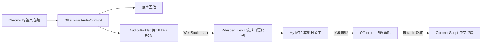

# Chrome 日语语音实时中文字幕方案

**开发入口**　实现扩展、切换后端或执行验收时，使用新版开发方案与 v1 合同。[可执行开发方案](development-plan.md) · [字幕协议与后端合同](subtitle-backend-contract.md)

**当前选型**　独立开发 Chrome 扩展。Mac 端首选 ReazonSpeech k2-v2 + sherpa-onnx + Silero VAD（600 ms）+ Hy-MT2 进入全量验收。[七组实测对比与原型方案](p0-asr-selection.md)

**原始方案**　下文保留 WhisperLiveKit 服务、协议与前端契约作为 P0 基线。扩展负责采音、会话隔离和网页字幕，并复用 JP Live Subtitle CN 的标签页采音思路和合适的 MIT 代码片段。

**首版目标**　在 Chrome 中播放没有原始字幕的日语视频，点击扩展后继续听原声，同时在视频上显示简体中文字幕。首轮验收覆盖 YouTube 和一个普通 HTML5 播放器，包括页面内全屏、暂停、拖动进度和切换视频。一次处理一个标签页，采到的是该标签页的混合音频。画中画、跨域内嵌播放器和受保护媒体单独验证后再承诺支持。

**验证状态**　2026-11-06 核对了上游源码和本机环境。本机是 Apple M1 Pro、32 GiB、macOS 26.7.2、Chrome 157，已有 ARM64 Python 3.12、uv 和 FFmpeg。WhisperLiveKit 的两组 MLX extras 已通过本机 Python 3.12 依赖解析 dry-run。模型加载、真实标签页采音、字幕质量和延迟待实测。

## 1. 上游取舍

| 路线 | 实际能复用的能力 | 决策 |
| --- | --- | --- |
| 独立扩展 + WhisperLiveKit | `/asr` 流式 WebSocket、MLX Whisper、VAD 和进程内日译中。可直接依赖上游 API。 | **主线。** 只维护扩展和一个薄启动器，升级前用录制的协议帧回归。 |
| 以 JP Live Subtitle CN 为主线 | 已有 MV3 采音、网页字幕、全屏容器处理和 mock 引擎。默认后端是 `whisper-large-v3-mlx-8bit` 加 `Qwen3-8B-4bit`，有自己的预览、切句和翻译策略。 | **参考前端，作为后端对照。** 接 WhisperLiveKit 需要换掉音频协议、字幕消费、会话路由和默认权限配置。对照实验时可以保持它自己的扩展和后端配套运行。 |
| 以 WhisperLiveKit 浏览器示例为主线 | 有 PCM Worklet 和网页转写 UI。扩展通过 `scripts/sync_extension.py` 复用网页 UI，默认走 popup，采音失败时可转麦克风。 | **参考 PCM 和协议。** 本项目的主入口、常驻采音、视频页浮层和失败行为单独实现。 |
| `whisper.cpp` + 独立翻译器 | Apple Silicon 可用 Metal，Core ML 可将编码器交给 ANE。`whisper-server` 的 `POST /inference` 接收文件上传，可作为分段识别 API。`whisper-stream` 是麦克风示例。 | **备选。** 可行的链路是 PCM → VAD 切段 → WAV POST → 日语 → 本地 MT → 中文字幕。滑窗去重、切句和排队需要自己维护。Whisper 的 `--translate` 目标是英语，日译中统一走文本翻译模型。 |

JP Live Subtitle CN 的 `service_worker.js`、`offscreen.js` 和 `content_script.js` 分别用于参考授权与注入、采音与原声回放、全屏浮层。保留直接复制片段的 MIT 版权及许可。其现有脚本使用广泛站点权限、默认开发凭据和 worker 内存中的当前标签页状态，扩展按第 3 节收敛这些边界。代码和模型分别记录许可证与 revision。WhisperLiveKit 与 Hy-MT2 1.8B 模型卡均标注 Apache-2.0，NLLB-200 distilled 600M 标注 CC-BY-NC-4.0。[JP 扩展源码](https://github.com/ruiw2674-cloud/jp-live-subtitle-cn/tree/c0aca604c7922c040b41fd74a6034262fb8cf976/apps/extension) · [JP 默认模型](https://github.com/ruiw2674-cloud/jp-live-subtitle-cn/blob/c0aca604c7922c040b41fd74a6034262fb8cf976/scripts/setup_real_mode.py) · [JP 许可证](https://github.com/ruiw2674-cloud/jp-live-subtitle-cn/blob/c0aca604c7922c040b41fd74a6034262fb8cf976/LICENSE) · [WhisperLiveKit 示例](https://github.com/QuentinFuxa/WhisperLiveKit/tree/13ee8515f136e0fd0bf31fb8ab0b63ab10670fa2/chrome-extension) · [WhisperLiveKit 许可证](https://github.com/QuentinFuxa/WhisperLiveKit/blob/13ee8515f136e0fd0bf31fb8ab0b63ab10670fa2/LICENSE) · [Hy-MT2 4-bit](https://huggingface.co/mlx-community/Hy-MT2-1.8B-4bit) · [NLLB 模型卡](https://huggingface.co/facebook/nllb-200-distilled-600M) · [whisper.cpp HTTP 示例](https://github.com/ggml-org/whisper.cpp/blob/727d3e7666485e12450746b523bfb4e7f057cc5e/examples/server/README.md) · [Apple Silicon 支持](https://github.com/ggml-org/whisper.cpp/blob/727d3e7666485e12450746b523bfb4e7f057cc5e/README.md#core-ml-support) · [麦克风示例](https://github.com/ggml-org/whisper.cpp/blob/727d3e7666485e12450746b523bfb4e7f057cc5e/examples/stream/README.md)

## 2. 本地链路与基线



- **ASR**　固定 `ja`，采用 `mlx-whisper` + SimulStreaming，先用多语种 `small` 建基线。仅换成 `large-v3-turbo` 做质量与延迟对照，保留表现更适合目标视频的一组。两个名字均有 MLX 模型映射。[模型映射](https://github.com/QuentinFuxa/WhisperLiveKit/blob/13ee8515f136e0fd0bf31fb8ab0b63ab10670fa2/whisperlivekit/model_mapping.py)
- **MT**　显式启用 `mlx-llm-mt` 和 `hy-mt2-1.8b-4bit`，目标 `zh-cn`。模型预热后开始采音。默认 MT 在识别确认的标点、VAD 静音开始或 EOF 时提交翻译，中文字幕延迟受切句等待和模型推理共同影响。固定版本内置的 simultaneous MT 校准仅有 `en→zh`、`zh→en` 的 8-bit 文件。日译中采用句段模式起步。[MLX 翻译](https://github.com/QuentinFuxa/WhisperLiveKit/blob/13ee8515f136e0fd0bf31fb8ab0b63ab10670fa2/docs/translation-mlx.md) · [翻译 profile](https://github.com/QuentinFuxa/WhisperLiveKit/blob/13ee8515f136e0fd0bf31fb8ab0b63ab10670fa2/whisperlivekit/translation_profiles.py) · [切句事件处理](https://github.com/QuentinFuxa/WhisperLiveKit/blob/13ee8515f136e0fd0bf31fb8ab0b63ab10670fa2/whisperlivekit/translation_processor.py) · [校准文件](https://github.com/QuentinFuxa/WhisperLiveKit/tree/13ee8515f136e0fd0bf31fb8ab0b63ab10670fa2/whisperlivekit/calibrations)
- **部署**　项目内 ARM64 Python 3.12 虚拟环境，一个本机服务进程和一个 WS 会话。首次联网获取依赖和模型，模型缓存设在固定目录。验收后记录并锁定依赖、ASR 和 MT 模型 revision，启动时使用已验收的缓存或本地快照。ASR 使用本地预热音频，验收时断网重启。运行时音频与字幕留在本机，默认日志仅保留计数、耗时和错误类别。[上游预热逻辑](https://github.com/QuentinFuxa/WhisperLiveKit/blob/13ee8515f136e0fd0bf31fb8ab0b63ab10670fa2/whisperlivekit/warmup.py)

## 3. 实现契约

### Chrome 与播放器

- 用 TypeScript 和 Manifest V3。点击扩展 action 后，service worker 先确保 Offscreen Document 存在，再为用户触发时的 `tabId` 取 `getMediaStreamId`。Offscreen 立即消费 ID 并建立 `USER_MEDIA` 音频链路，WS 收到 `config` 后开始发送。使用 `activeTab`、`scripting`、`tabCapture`、`offscreen`、`storage`，按需注入顶层页面。扩展发起的 HTTP 健康探测只声明 `http://127.0.0.1/*`，扩展页 CSP 将网络目的地收敛到约定的 loopback 端口。最低 Chrome 116，以本机 Chrome 157 验收实际 loopback 权限行为。采音或连接失败时显示原因，释放音轨，恢复原声。[Chrome 采音流程](https://developer.chrome.com/docs/extensions/how-to/web-platform/screen-capture#record_audio_and_video_in_the_background) · [activeTab](https://developer.chrome.com/docs/extensions/develop/concepts/activeTab) · [Chrome 本地网络访问](https://developer.chrome.com/docs/modern-web-guidance/guides/security/local-network-access)
- Offscreen 持有音轨、AudioContext、WS 和 `{tabId, epoch}`。原声支路直连 `audioContext.destination`，采音支路在 Worklet 中保持有状态的降采样，按实际输入采样率下混并经抗混叠滤波转为 16 kHz 单声道。Worklet 输出静音以免双播。初始每 **200 ms** 发一帧，每帧 **3,200 样本 / 6,400 字节**。以 44.1 和 48 kHz 输入验证重采样时长、双声道下混及帧边界连续性。[Chrome 原声回放](https://developer.chrome.com/docs/extensions/reference/api/tabCapture)
- service worker 负责按 `tabId` 路由，重启后向 Offscreen 读取当前会话。消息同时校验来源和 `epoch`。切换浏览器标签页时继续服务最初授权的标签页，点另一个标签页的 action 时先结束旧会话。普通网页导航或标签页关闭即停止。暂停、`seeking`、播放器换源或 SPA 换视频时清空字幕并作废旧 WS，恢复播放时用新 `epoch` 和 WS 从当前位置采音。连续拖动只恢复最后一次；等待旧会话清理，短暂占用时至多重试一次。轨道结束或连接中断时释放资源，由用户再次启动。
- Content Script 只负责可见播放器事件和浮层。首版选择顶层主要可见 `<video>`。普通布局贴近视频底部，容器全屏时把 Shadow DOM 宿主移到全屏容器内。全屏元素本身是 `<video>`、跨域 iframe 或画中画时按实际验证结果提示支持状态。字幕以 `textContent` 渲染，用扩展图标和页面状态显示连接、运行或失败。

### WebSocket 与字幕

| 方向 | 首版契约 |
| --- | --- |
| 扩展 → 本机 | `ws://127.0.0.1:18765/asr?mode=full&token=<随机令牌>`。等待 `config.useAudioWorklet=true` 后发送二进制 PCM s16le，显式写小端。采音期间正常送静音样本以保留时间轴。正常播完或回放脚本送空二进制帧并等 `ready_to_stop`。用户停止、拖动和失败时直接作废会话。 |
| 本机 → Offscreen | `config`、无 `type` 的 `lines` 快照、`ready_to_stop` 或错误。`lines[*].translation` 有值才参与中文渲染。`buffer_transcription` 只供测量日文预览，`translation_error` 作为状态处理。跳过 `speaker=-2` 的静音行。 |
| Offscreen → 浮层 | 仅发送 `{tabId, epoch, revision, zh}` 或清空与状态事件。`revision` 在同一会话内随实际字幕更新递增。浏览器端记录快照收到和页面上屏时间。 |

JP Live Subtitle CN 的 WS 先发送 JSON `start` 和采样率，后续发送 Float32 单声道，并返回 `subtitle` 事件。WhisperLiveKit 的 `/asr` PCM 路径期望的是原始二进制 PCM 帧。替换采音编码和协议适配后才能对接。[JP 协议](https://github.com/ruiw2674-cloud/jp-live-subtitle-cn/blob/c0aca604c7922c040b41fd74a6034262fb8cf976/docs/architecture.md#mvp-protocol) · [WhisperLiveKit 协议](https://github.com/QuentinFuxa/WhisperLiveKit/blob/13ee8515f136e0fd0bf31fb8ab0b63ab10670fa2/docs/API.md#websocket-streaming-api) · [服务端实现](https://github.com/QuentinFuxa/WhisperLiveKit/blob/13ee8515f136e0fd0bf31fb8ab0b63ab10670fa2/whisperlivekit/basic_server.py)

**快照更新。** 固定使用 `mode=full` 并显式设置 `--retention-seconds 30`，避免每次回传整部视频的历史。当前行可能继续长出日文和中文，已出现的日文行也可能稍后补译。按源顺序比较相邻快照，用同一 `start` 和说话人关联仍在窗口内的行；秒以下精度按实际序列化的 `H:MM:SS.cc` 解析。文本未变时保持字幕和停留计时。严格前缀增长且追加内容非空时显示新增中文。已有译文被改写时替换当前行。若多行同时更新，按源顺序取最新的可用内容。历史晚到结果不能覆盖已经显示的更新行。无更新约 4 秒清空。用于诊断的行级时间来自 ASR 采样时间轴，实际句级延迟用独立标注测量。先用连续对白快照证实追加、晚补和多行合并在验收覆盖率内，再决定是否需要后端显式输出译句时间与 ID。[历史保留及行归并](https://github.com/QuentinFuxa/WhisperLiveKit/blob/13ee8515f136e0fd0bf31fb8ab0b63ab10670fa2/whisperlivekit/tokens_alignment.py) · [时间序列化](https://github.com/QuentinFuxa/WhisperLiveKit/blob/13ee8515f136e0fd0bf31fb8ab0b63ab10670fa2/whisperlivekit/timed_objects.py)

**背压。** 持续对照捕获进度和 `remaining_time_transcription`，客户端 `bufferedAmount` 超过约 2 秒音频量（64,000 字节）时终止当前会话并提示跟不上。引擎侧把音频队列预算起设为 4 秒，队列满等待起设为 1 秒。禁止静默丢中间帧后继续沿用旧时间轴。持续字幕积压或 MT 错误要在状态中可见。[引擎队列选项](https://github.com/QuentinFuxa/WhisperLiveKit/blob/13ee8515f136e0fd0bf31fb8ab0b63ab10670fa2/docs/configuration.md)

**本地准入。** 启动器在同一进程内包装 `whisperlivekit.basic_server.create_app`，对浏览器只开放 `/asr` 和无敏感字段的 `/health`。绑定 `127.0.0.1`，固定端口，校验 WebSocket 的 `Host` 和精确 `chrome-extension://<扩展 ID>` Origin，再交给 WhisperLiveKit 验证随机 `WLK_API_TOKEN`。使用内建 query token 兼容浏览器 WS，关闭会记录请求 URL 的日志，包括握手路径日志。令牌只保存在扩展的受信任上下文，不进网页、同步存储和诊断文件。验收时分别从扩展、普通页面、错误令牌和本机以外验证边界。健康探测由扩展页发起，CORS 如有需要只允许该扩展 Origin。[上游鉴权实现](https://github.com/QuentinFuxa/WhisperLiveKit/blob/13ee8515f136e0fd0bf31fb8ab0b63ab10670fa2/whisperlivekit/api_auth.py) · [WebSocket Origin](https://www.rfc-editor.org/rfc/rfc6455.html#section-10.2) · [扩展存储访问级别](https://developer.chrome.com/docs/extensions/reference/api/storage#type-AccessLevel)

## 4. 按顺序实现与验收

### P0　先证明实时日译中

[本机 P0 实测报告](p0.md)记录两组模型的延迟、语义覆盖和中断。后续选型使用实测结果。

后续本机模型短测统一保留原速回放、静音和资源采样。使用 `p0/monitor.py` 记录进程 CPU、统一内存峰值、整机 GPU 使用率和 GPU 驱动报告的内存。比较时附启动前的整机采样和片段范围。[采样口径与复现命令](p0-nemotron.md)

从当前项目目录执行以下基线命令。三个上游已通过 `gh repo clone … -- --depth 1` 下载到同级目录。先确认环境创建和依赖安装成功，再启动服务。启动时用仓库已有 WAV 触发 ASR 预热，日语识别效果用后续回放单独验证。

```sh
uv venv --python 3.12 .venv
test "$(git -C ../WhisperLiveKit rev-parse HEAD)" = 13ee8515f136e0fd0bf31fb8ab0b63ab10670fa2 &&
  uv pip install --python .venv/bin/python '../WhisperLiveKit[mlx-whisper,mlx-llm-mt]'

export WLK_API_TOKEN="$(.venv/bin/python -c 'import secrets; print(secrets.token_urlsafe(32))')"
.venv/bin/whisperlivekit-server \
  --host 127.0.0.1 --port 18765 --pcm-input \
  --warmup-file ../whisper.cpp/samples/jfk.wav \
  --backend mlx-whisper --backend-policy simulstreaming --model small \
  --language ja --target-language zh-cn \
  --translation-backend mlx-llm-mt --mlx-llm-mt-model hy-mt2-1.8b-4bit \
  --retention-seconds 30 --max-concurrent-sessions 1 \
  --max-buffered-audio 4 --backpressure-timeout 1 --log-level WARNING
```

用 `curl -fsS http://127.0.0.1:18765/health` 检查 `ready`。回放脚本复用 `test_client.py` 的 FFmpeg 转 PCM 逻辑，从进程环境读取令牌，用 `Authorization: Bearer` 握手，按单调时钟每 200 ms 发送 6,400 字节，并行收结果，末尾发送空帧。先各挑一段有标点、有停顿和连续对白的音频，另加纯音乐或静音负样本。在 Chrome 开工前确认出现日文转写和简中翻译，记录切句、译文到达和 EOF 行为。使用同一批音频对比 `small` 和 `large-v3-turbo`，初始 MT 量化保持相同。[上游回放客户端](https://github.com/QuentinFuxa/WhisperLiveKit/blob/13ee8515f136e0fd0bf31fb8ab0b63ab10670fa2/whisperlivekit/test_client.py)

**完成条件**　至少一组通过第 5 节服务端回放门槛。提交所用命令、模型 revision、延迟分布、漏译和典型错译样本作为实现证据。若落后先按第 5 节定位，优先修实测瓶颈。

### P1　证明 Chrome 音频与页面生命周期

用 WS mock 先贯通采音、原声回放、快照适配和网页渲染，再接入 P0 的引擎与启动器。实现文件按职责放在 `extension/`（worker、offscreen、Worklet、协议适配、overlay）和 `engine/`（本机启动与配置）。协议测试用 P0 回放里录下的脱敏快照，mock 覆盖错误和晚到事件。

**完成条件**　普通 HTML5 测试页和 YouTube 都能以用户点击启动，只在目标标签页叠加字幕，原声正常。验证关闭 popup、worker 休眠重启、两标签页切换、暂停恢复、连续拖动、SPA 换视频、导航、全屏和引擎断开。旧会话字幕不串入，停用后无采音轨、WS 或陈旧浮层。错误令牌、普通网页 Origin 和引擎不可达都有可观察结果。

### P2　按实际观看效果收口

用同样的样本集走真实 Chrome → 本地引擎 → 浮层。补齐一键启动本地服务、手动加载 unpacked 扩展、第一次下载模型与后续离线使用的说明。最终交付扩展、依赖锁、启动器、回放脚本、安装说明与验收数据。

**完成条件**　满足第 5 节上屏指标。完成 60 分钟持续播放，字幕延迟和内存没有持续爬升。验证 1.5× 播放的顺序与会话正确性，单列其性能结果。模型缓存完成后用本地视频做断网重启验证。保留一条可复现的主配置。

## 5. 实时性和质量门槛

准备约 20–30 分钟可合法复测的日语音频，至少标注 100 个语义完整短句，覆盖清晰独白、连续快速对白、背景音乐或多人重叠，附静音负样本。给每句标注可听结束时间和中文关键含义。回放与 Chrome 均按 1× 实时供流。下表是首轮验收目标，依据 M1 Pro 实测再调整。

| 指标 | 首轮通过条件 |
| --- | --- |
| 句末到中文 | 预热后，P0 以首个匹配的中文 WS 结果为终点，P2 以页面首次显示可用中文为终点。两处都以人工标注的句末为起点，目标 P50 ≤ 1.5 秒、P95 ≤ 3 秒。提前显示按 0 秒计，另记录提前量。 |
| 首条字幕 | 预热后记录从第一句开始到首条可用中文字幕的时间。对首句长度在 1–3 秒的片段，目标 P90 ≤ 4.5 秒。冷启动和模型预热单列。 |
| 覆盖与语义 | 至少 90% 的标注句能在句末后 5 秒内找到可用中文。人工核对主语、否定、数字和专名等关键语义，单列错译、漏译、重复和过期比例。统计延迟时同时报告未匹配的分母。纯静音样本不应出现字幕。 |
| 持续播放 | 60 分钟中分段比较开头、中间和结尾的 P95、队列与内存，持续增长或触发积压中断都需要定位。记录内存压力和峰值，确认原声无中断。 |

**定位顺序**

1. **先分清耗时在哪。** 分别记录首个日文预览、ASR 确认、MT 提交和完成、WS 接收与页面上屏。页面间以 `performance.timeOrigin + performance.now()` 对齐测量。P0/P2 的句末通过同一标注、音频样本位置和实际播放锚点对应。定位引擎内部耗时时用本地临时计时，确认了的字幕行也可能增长，`remaining_time_transcription` 只用来判断 ASR 积压。
2. **ASR 慢或错。** 比较 `small` 和 `large-v3-turbo` 的日文 CER、实际错字类型与队列。确认窗口重复编码占比后，再 A/B 调整送帧间隔或 ASR 合批参数，每次只改一个。若 MLX ASR 在本机持续积压，用同批 PCM 对照 `whisper.cpp` 的 Metal 路径，仍保留相同 MT。
3. **切句慢。** 长段落无标点或停顿时，先确认 ASR 已经给出可用日文。若该类样本拉高 P95，优先评估在稳定短语边界提早提交，必要时以约 4 秒稳定语音作为试验的软触发，比较新旧版本漏译、重复和专名错译。若瓶颈在快照把多条译句合成一行，则做最窄的上游变更或补丁，暴露每条已完成 `Translation` 的时间范围与稳定 ID。两种情况用相同日语样本复测后决定是否采用补丁。
4. **MT 慢或质量差。** 用同一批已标注日文句段隔离 MT 成本。推理速度或译文质量确实成为主因时，再对照 8-bit 或 JP Live Subtitle CN 的本地 Qwen 翻译路径。任何候选都以端到端的中文上屏和语义覆盖决定去留。

## 审查基线

| 上游仓库 | 分支与已核对提交 |
| --- | --- |
| `WhisperLiveKit` | `main` · `13ee8515f136e0fd0bf31fb8ab0b63ab10670fa2` |
| `jp-live-subtitle-cn` | `main` · `c0aca604c7922c040b41fd74a6034262fb8cf976` |
| `whisper.cpp` | `master` · `727d3e7666485e12450746b523bfb4e7f057cc5e` |
