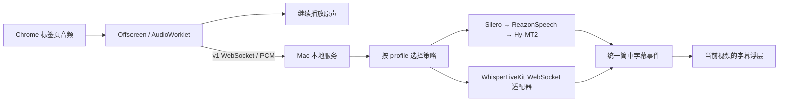

# Chrome 日语视频实时中文字幕开发方案

## 实施入口

从仓库根目录按 D1–D5 执行。每阶段完成交付和验收后进入下一阶段，失败保留证据并修复当前阶段。实现前读取对应章节的合同。运行和复测前读[本机使用说明](local-setup.md)。阶段完成状态见[本机验收记录](v1-acceptance.md)。

首版在 Apple Silicon Mac 本地运行。用户在 Chrome 点击扩展，继续听原声，同时在当前视频上看到**简体中文字幕**。输入只有标签页 PCM 音频。一次服务一个标签页，覆盖普通顶层 HTML5 视频和 YouTube。原始字幕、麦克风、字幕文件导出、多标签页并发、画中画、跨域播放器和受保护媒体留到明确需求后评估。

默认配置用 **ReazonSpeech k2-v2 + sherpa-onnx CPU + Silero VAD（600 ms）+ Hy-MT2 1.8B 4-bit**。首版同时交付一个可配置启用的 WhisperLiveKit 适配器，验证不同后端能走同一浏览器协议。它是对照配置，默认关闭。两段短测中，默认候选的可用中文句末 P95 为 1.94 / 2.97 秒，5 秒内各命中 4 条，质量仍需通过 D5。[实测、模型 revision 和复现](p0-asr-selection.md)

## 结构



| 目录 | 职责 |
| --- | --- |
| `protocol/` | v1 消息 schema、共用测试样例。字段与状态机按[协议合同](subtitle-backend-contract.md#浏览器协议)实现。 |
| `engine/` | Python 3.12、FastAPI、Uvicorn 单 worker。本地入口、配置、队列、后端适配器、回放命令和测试。依赖用 `uv.lock` 锁定。 |
| `extension/` | TypeScript、Manifest V3。worker 路由，Offscreen 持有采音与连接，Worklet 处理 PCM，Content Script 管播放器和浮层，Options 管配置。依赖用 `package-lock.json` 锁定。 |
| `p0/` | 现有原速样本、评分和 Mac 资源采样。保留既有结果，新运行写入单独目录。 |

## D1 建立合同与本地服务

1. 写协议 schema、共享 JSON fixtures 和本地配置样例。实现 `subtitle-server --config <path>`，启动前校验配置，先用测试注入的确定性策略验证链路。
2. 接通 `GET /v1/health`、`GET /v1/profiles` 和 `WS /v1/captions`。实现 loopback、Origin、令牌、会话独占、队列上限、状态机和清理。按[协议合同](subtitle-backend-contract.md#浏览器协议)写测试，错误状态从协议输出观察。
3. 实现 `subtitle-replay`。读取 `p0/fixtures/suite.json` 并复核 SHA-256，按 200 ms 原速送 PCM，记录 WS 接收时钟，正常结束等待 `finished`。`--launch-config` 由回放器启动并清理服务子进程，便于 `p0/monitor.py` 一起采样。回放器写已有采样器约定的 `P0_RESOURCE_PHASES` 片段边界，服务运行时无需载入 P0 工具。

**完成条件**　合法连接收到且只收到该会话的简中测试字幕。错误令牌、错误 Origin、未知配置、未就绪、第二连接、错误 PCM、背压、正常 drain 和取消均有定向测试。取消后无旧字幕，下一会话可启动。共享样例可被 Python 和 TypeScript 消费。

## D2 接入默认本地引擎

1. 从 `p0/reazonspeech.py` 复用实测的 Silero 与 sherpa 调用、模型路径和 600 ms 参数。服务把 VAD、解码与翻译状态绑定到会话，初始化复用模型，按[策略合同](subtitle-backend-contract.md#后端策略)隔离阻塞推理和 WS I/O。
2. 固定日语输入和简中输出。将现有 Hy-MT2 调用封装在一个 adapter，锁定 WhisperLiveKit revision，主流程只依赖该 adapter 的翻译方法。统一清理空译文与夹带日文的输出，日文只可在主动开启的本地评测证据里查看。
3. 用真实配置跑两段原速有声样本与 10 秒静音。记录 ASR、切段、MT、WS 到达、EOF 和资源，逐句复核。用正确日文直送翻译复核「片假名」一类错误，定位分段、识别和翻译各自的问题。

**完成条件**　从 PCM 经真实 WS 返回可复核的简体中文字幕，两段有声回放都收到 `finished`，静音零字幕。至少一条样本结果保留正确的否定、主语或术语。记录与短测的差异。D2 证明服务链路，观影质量在 D5 验收。

## D3 接通 Chrome 和播放器

1. 工具栏 action 点击启动或停止，用 Options 显示服务状态、配置下拉框和令牌设置。使用 `activeTab`、`scripting`、`tabCapture`、`offscreen`、`storage`，按用户点击注入顶层页面。HTTP 权限限制在 loopback，扩展页 CSP 的 `connect-src` 限制到 v1 端口。Service Worker 创建 `USER_MEDIA` Offscreen 后获取 stream ID，Offscreen 消费并立即把原声接到 `AudioContext.destination`。以 Chrome 116 为采音 API 下限，以本机 Chrome 实测 loopback 请求与权限行为。[Chrome 标签页采音和原声回放](https://developer.chrome.com/docs/extensions/reference/api/tabCapture) · [后台采音流程](https://developer.chrome.com/docs/extensions/how-to/web-platform/screen-capture#record_audio_and_video_in_the_background)
2. Offscreen 拥有音轨、Worklet、WS 和 `tabId + epoch`。Worklet 按实际采样率下混，带抗混叠滤波重采样，跨帧保留状态，输出小端 PCM。测试 44.1/48 kHz、单/双声道、尾帧和连续性。Worker 休眠恢复后向 Offscreen 查询现有会话。Offscreen 收到 `ready` 后才从当前音频开始向服务送帧。
3. Content Script 选择顶层主视频，优先可见的播放中视频，按显示面积决胜。绑定主视频生命周期并校验 `tabId + epoch + session_id`。普通布局使用隔离样式的字幕浮层，以 `textContent` 渲染；容器全屏时把浮层放入全屏容器。首版按有效字幕到达时间显示，连续无更新 4 秒清空。音频样本时间用于追踪和验收，播放进度条变化通过新会话处理。
4. 按[播放生命周期合同](subtitle-backend-contract.md#播放生命周期)处理暂停、拖动、结束、换视频、导航和停止。切换浏览器标签页继续处理原授权标签页，只有在另一个标签页点击 action 才接管。连接或采音失败时显示原因，释放音轨和浮层。

**完成条件**　在本机 Chrome 对普通 HTML5 测试页和 YouTube 实际点击 action，原声正常且只有授权标签页显示中文。复测暂停恢复、连续拖动、YouTube SPA 换视频、容器全屏、服务断开、Worker 重启、停用、两标签页接管。旧响应和旧定时器均无法修改新浮层。没有可用浮层的全屏模式应显示明确支持状态并留验收记录。

## D4 验证真实后端切换

1. 实现 `whisperlivekit_ws`，用保留的短测快照验证滚动裁剪、文本增长、重复、晚到和断连。在单独 loopback 端口启动已锁定版本的 WhisperLiveKit 验证真实 PCM 与中文。协议差异全部由 adapter 消化。按[扩展后端合同](subtitle-backend-contract.md#新增后端)实现。
2. 在 Options 从服务拉取已配置的 profiles，保存 `profile_id`。启用第二配置后，用同一版扩展依次选择 ReazonSpeech、WhisperLiveKit、ReazonSpeech。每次新启动按所选类型建新会话。原型阶段用第一个配置作为正常观看的默认项。

**完成条件**　两种真实后端均从同一 v1 入口返回相同形状的简中字幕，扩展无按后端名称分支。切换不修改扩展代码或协议，活动会话维持原配置。第二后端掉线、停用和配置写错能区分并提示。留一份测试记录，证明新增 adapter 只改服务工厂、配置和 adapter 测试。

## D5 全量验收与本机交付

1. 用现有 17 段套件在服务入口全量原速回放。量化首条可用、句末 P50/P95、5 秒覆盖、15 秒漏错、重复、静音、积压和资源。用同一批音频和 P0 评分规则对比，带配乐辅助标注另列。任何改动导致分段或中文过滤变化，重新逐句判定该轮输出。
2. 若质量不达标，逐段对照原音频、VAD 范围、日文输出和直送正确日文的翻译结果。每次验证一个影响因素。先缩小到导致漏错的样本，再跑全量。保留原始输出与判定、模型 revision、参数和运行命令。
3. 在真实 Chrome 复测上屏。用本地视频验证断网重启、60 分钟连续播放、1.5× 的字幕顺序与会话重置。量化 60 分钟前、中、后各段延迟、队列、CPU、GPU 与统一内存。P0 同时记录空闲 GPU 基线。交付首次下载模型、加载 unpacked 扩展、从 `chrome://extensions` 复制扩展 ID 配置 Origin、启动本地服务和在 Options 录入令牌的步骤。

**交付门槛**　1× 句末到可用中文 P50 ≤ 1.5 秒、P95 ≤ 3 秒，5 秒内语义正确覆盖 ≥ 90%，静音零字幕。对 1–3 秒短句，语音开始到首条可用 P90 ≤ 4.5 秒。60 分钟无持续积压、会话串线、原声中断或资源持续增长。服务端和上屏分开报数。未通过的结果标为原型，并列出失败指标及复现样本。

### 实现后运行的命令

```sh
uv sync --project engine --frozen
uv run --project engine --frozen pytest -q engine/tests
npm --prefix extension ci
npm --prefix extension run typecheck
npm --prefix extension test
npm --prefix extension run build
uv run --project engine --frozen subtitle-server --config engine/config/profiles.toml
```

全量回放与手动服务启动分开执行，避免端口冲突。省略 `--clips` 跑全套。

```sh
mkdir -p p0/evidence
/usr/bin/caffeinate -is .venv/bin/python p0/monitor.py p0/evidence/v1-reazon-resources \
  uv run --project engine --frozen subtitle-replay \
  --launch-config engine/config/profiles.toml --profile reazon-hy \
  --suite p0/fixtures/suite.json --output p0/evidence/v1-reazon
```
