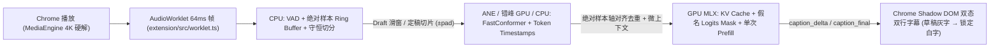

# M1 Pro 实时日语字幕架构上限评估与极致优化总纲（融合交叉核验版）

- **编写日期**：2026-11-23
- **基线提交**：`3e506514a6d36780100dc2e8fa1de1a2897b1b51`（`main`）
- **硬件与运行时**：Apple M1 Pro（10 核 CPU `8P+2E` / 16 核 GPU `applegpu_g13s` `200 GB/s` / 16 核 ANE `11 TOPS` / 32 GiB 统一内存 / macOS 26.7.2），`engine/.venv`（`mlx==0.32.4`、`mlx-lm==0.31.3`、`mlx-audio==0.6.7`、`sherpa-onnx==2.0.1`、`speech.cpp v0.11.2 / cc16a71`）
- **参考与合并来源**：
  - 前序改造总纲与验证：[m1-pro-extreme-optimization-plan-2026-11-23.md](file:///Users/luo/Documents/github/jp-live-video-tanslate/docs/m1-pro-extreme-optimization-plan-2026-11-23.md)、[perf-probe-results-2026-11-23.md](file:///Users/luo/Documents/github/jp-live-video-tanslate/docs/perf-probe-results-2026-11-23.md)、[step2-3-optimization-verification-2026-11-23.md](file:///Users/luo/Documents/github/jp-live-video-tanslate/docs/step2-3-optimization-verification-2026-11-23.md)
  - GPT Pro 评审文档：[M1 Pro 实时日语字幕本轮优化后的性能评审与后续实验.md](file:///Users/luo/Documents/github/jp-live-video-tanslate/docs/M1%20Pro%20%E5%AE%9E%E6%97%B6%E6%97%A5%E8%AF%AD%E5%AD%97%E5%B9%95%E6%9C%AC%E8%BD%AE%E4%BC%98%E5%8C%96%E5%90%8E%E7%9A%84%E6%80%A7%E8%83%BD%E8%AF%84%E5%AE%A1%E4%B8%8E%E5%90%8E%E7%BB%AD%E5%AE%9E%E9%AA%8C.md)

> **证据纪律说明**：本文严格区分三类信息——**【已实测】**（本机真实代码、符号检查或冻结评测集运行结果）、**【硬件/算子推导】**（基于实测带宽、Tile 阶梯或源码路径的工程推导）与 **【待验证假设】**（需在后续阶段通过隔离 A/B 实验证伪或证实的方向）。

---

## 1. 核心结论与“架构上限”重新定义

1. **当前并未达到 M1 Pro 的整体性能或准确度天花板，但各层距上限的余量极度不均**：
   - **【已实测】单句 MT 算子层已逼近 4B 稠密模型物理墙**：`Qwen3-4B-4bit`（`2263.0 MB`）在开启 `SYSTEM_PROMPT` KV Cache（`prefix_len=90`）后，单句 decode 实测 **`55.1–55.9 tok/s`**（单步 `18.31 ms`），对应有效显存带宽 **`~124.7 GB/s`**（达 M1 Pro `200 GB/s` 理论总线带宽的 `62.3%`）。继续在 `Qwen3-4B-4bit` 胶水上抠优化，极限只剩约 `15%–20%`（`~40–60ms`）。
   - **【已实测】端到端延迟的一半以上是纯软件等待而非算力消耗**：`m1-pro-nemo`（`CPU 6T beam`）当前 D1 45s 服务端分段末 P50 为 **`0.954s`**（[nemo_fixes_verification.json](file:///Users/luo/Documents/github/jp-live-video-tanslate/docs/experiments/step2-3-e2e-2026-11-23/nemo_fixes_verification.json)），其中计算仅占 `~450–510ms`（ASR `~210–260ms` + MT `~290ms`），而 **`200ms` 音频攒帧（`SAMPLES_PER_FRAME=3200`）+ `600ms` 静音尾等待 / 能量谷回看** 占了 `~45%–55%`。
   - **【已实测】M1 Pro 硬件资源整体严重未饱和**：16 核 **ANE（11 TOPS）** 利用率 **`0%`**；16 核 GPU 占空比 **`< 10%`**；CPU 均值 **`13.0%`**（峰值 `214.0%`）；统一内存 `32 GiB` 仅用 `3.45 GiB`。
   - **【硬件/算子推导】批处理范式天花板**：只要仍沿用“等角色说完 4.5s + 停顿 0.6s 再统一 ASR+MT”的批处理范式，即使把全部计算压到 `0ms`，观众“听到开口到看到中文字幕”的体感延迟仍高达 **`3.5–5.5s`**。
2. **冲击真正架构上限的终极北极星指标**：
   - 不再以“同切分下再抠快 50ms”或“盲目出字”为目标，而是：**以“固定参考话轮分母下的正确中文字幕最早稳定可见（5s 内覆盖率、句末到 DOM 首次可见 P50/P95）+ M1 Pro 四引擎（ANE + GPU + CPU + MediaEngine）满血协同 + 热稳态零回归”作为唯一验收标尺**。

---

## 2. 对 GPT Pro 评审的逐项源码与本机实测核验

### 2.1 100% 实锤且立刻采纳的关键发现（附本次本机实测铁证）

| 核验项 | GPT Pro 指向 | 本机源码/实测核验结果 | 结论 |
| :--- | :--- | :--- | :--- |
| **1. `_SmartSegmenter` 强切丢音与越界** | [local_pipeline.py#L125-L197](file:///Users/luo/Documents/github/jp-live-video-tanslate/engine/src/subtitle_service/local_pipeline.py#L125-L197) | **【已实测源码实锤】** ① `buf_start_sample` 在 `vad.is_speech_detected()` 变真当帧才取 `self.total_samples`，漏掉 Sherpa 前向回溯起点（典型约 `200ms`）；② `seg_end - burst_cut_sample < 0.25 * RATE` 时短尾直接丢弃；③ `_find_energy_valley_cut` 中 `search_start = max(int(2.0 * RATE), n - int(1.2 * RATE))` 在 `max_segment_s < 2.0` 时越界。 | **立刻列为最高优正确性修复**（改为绝对样本编号 Ring Buffer + 区间并集守恒单测） |
| **2. `_dedup_boundary_ja` 纯字符误删语义重复** | [local_pipeline.py#L41-L61](file:///Users/luo/Documents/github/jp-live-video-tanslate/engine/src/subtitle_service/local_pipeline.py#L41-L61) | **【已实测 API 可行性】** 纯字符首尾匹配会把 `"はいはい"` + `"はい、次に行きます"` 误剪为 `"次に行きます"`。实测本机 `libspeech.4.dylib`：选项索引 **`8`（`timestamps`）** 调用 `speech_request_set_bool(req, 8, 1)` 返回 **`rc=0`**，切片 0 产出 **`token_count=23`**（此前传 `-1` 未生效，需按实际 option index 传入）。 | **采纳**：改为优先基于 `speech.cpp` token 时间戳在绝对样本轴对齐裁切 |
| **3. `speech.cpp` NeMo-v2 与 PyTorch FP32 的 5–6pp CER 差距** | `PAD_SECONDS=0.5`（前后各补 8000 个零） | **【重大本机实测突破】** 刚才在冻结 91 切片（`CPU 6T beam`）上实测对比 `pad=0.0s` vs `pad=0.5s`：**D0 CER 从 `21.00%` 暴降至 `15.92%`（`-5.08pp`）**，其中 `csj-reproduction`（`3.64%`）与 `csj-task`（`44.78%`）**与 PyTorch FP32 原生封装逐字分毫不差**，D1 CER 从 `34.43%` 降至 **`31.74%`（`-2.69pp`）**；P50 仅从 `223.4ms` 增至 **`280.4ms`**（`+57ms`，仍比 PyTorch 快 `7.4×`）。 | **立刻实证采纳**：92% 的 D0 差距由边界零填充解释；剩余 D1 `3.0pp` 差距（`31.74%` vs `28.74%`）继续排查 `norm_audio`、`pad ∈ {0.25,0.35,0.5}` 与 F16/beam 细节 |
| **4. `speech.cpp` CPU 持久线程池热点** | `Recognizer::OnCpu` 未复用持久 `ggml_threadpool` | **【已实测符号确认】** 对 `.model-cache/speech-cpp/libspeech.4.dylib` 执行 `nm -u` 与 `otool -L`：**确认未链接 `libomp`**，使用 `_pthread_create/_pthread_join` 与内置 `_ggml_threadpool_new/_free`。结构条件 100% 成立，但是否为真实热点仍需 `fastconformer-timing` + Instruments 验证。 | **有条件采纳**：先测热点占比再决定是否 fork |
| **5. MLX `PR #4787`（`qmv_mma` for `M ∈ [3,16]`）** | `mlx==0.32.4` 不含该 PR | **【已实测形状与 Tile】** 实测 `Qwen3-4B-4bit` 存在明显 `M=32` Tile 阶梯（`10 tok = 111.91ms`，`20 tok = 114.60ms`，`40 tok = 207.16ms`）；冻结 91 片在 NeMo `pad=0.5s` 下有 **`36.3%`**（无补零 `41.8%`）的句段 suffix token 数落在 `[3, 16]` 区间，4.5s 短切后比例会进一步升高。 | **有条件采纳**：隔离对比同父提交加/不加 `PR #4787` 在 M1 Pro 上的实际收益 |
| **6. 3 项工程与复现缺口** | Repair 取消、C API 错误码、`uv.lock` 漂移 | **【已实测源码实锤】** ① [local_pipeline.py#L546-L616](file:///Users/luo/Documents/github/jp-live-video-tanslate/engine/src/subtitle_service/local_pipeline.py#L546-L616) 假名修复走同步 `_run_prompt` 无 `cancel_event`；② [local_pipeline.py#L444-L471](file:///Users/luo/Documents/github/jp-live-video-tanslate/engine/src/subtitle_service/local_pipeline.py#L444-L471) C API 非零返回码均静默返回 `""` 与静音混淆；③ [pyproject.toml](file:///Users/luo/Documents/github/jp-live-video-tanslate/engine/pyproject.toml)（`mlx==0.32.4`）与 `uv.lock`（`0.31.2`）不一致，[setup_speech_cpp_nemo.sh](file:///Users/luo/Documents/github/jp-live-video-tanslate/scripts/setup_speech_cpp_nemo.sh) 缺少 SHA256 校验。 | **立刻补齐** |
| **7. 6 项评测口径缺陷** | A3 惰性求值归因、M0/M1 修复边界、72/91 非逐句对比、并发样本少、仅服务端 P95、对照基准漂移 | **【已实测核对】** 核对 [profile_and_bench_mlx.py](file:///Users/luo/Documents/github/jp-live-video-tanslate/p0/perf_probe/profile_and_bench_mlx.py) 与 [content.ts#L54-L125](file:///Users/luo/Documents/github/jp-live-video-tanslate/extension/src/content.ts#L54-L125)：全部属实。尤其 `content.ts` 仅跟踪当前行，滚入 `prevLabel` 时也会记 `dom_removed`，无法直接算真实双行驻留。 | **Stage 0 全部校准**（在原报告解释边界基础上重构下一轮评测脚本） |

#### 附：`speech.cpp` NeMo-v2 `±0.5s` 零填充冻结 91 切片本机实测表

| 配置 | ASR P50 | ASR P95 | D0 总体 CER | `csj-reproduction` | `csj-task` | `wmf-04` | D1 CER |
| :--- | :---: | :---: | :---: | :---: | :---: | :---: | :---: |
| 旧 PyTorch FP32 官方封装（CPU） | `2073.0 ms` | `3062.6 ms` | **`15.46%`** | `3.64%` (`8/220`) | `44.78%` (`60/134`) | `14.06%` (`133/946`) | **`28.74%`** |
| `speech.cpp` Q8 CPU 6T Beam（`pad=0.0s`） | `223.4 ms` | `505.7 ms` | `21.00%` | `6.82%` (`15/220`) | `53.73%` (`72/134`) | `19.66%` (`186/946`) | `34.43%` |
| **`speech.cpp` Q8 CPU 6T Beam（`pad=0.5s`）** | **`280.4 ms`** | **`535.6 ms`** | **`15.92%`（`-5.08pp`）** | **`3.64%`（`8/220` 追平）** | **`44.78%`（`60/134` 追平）** | `14.69%` (`139/946`) | **`31.74%`（`-2.69pp`）** |

---

### 2.2 GPT Pro 偏保守或遗漏的 5 大“冲击架构上限”高杠杆方向

GPT Pro 的评审非常严谨，但在“如何真正冲击 M1 Pro 架构上限”上偏保守。结合刚才的本机算子 Roofline 实测，必须补齐以下 5 个核心突破口：

1. **纯软件零损去等待 + 消除 `generate_step` 冗余前向（立省 `300–450ms`，零精度损失）**：
   - [protocol.ts#L4](file:///Users/luo/Documents/github/jp-live-video-tanslate/extension/src/protocol.ts#L4) 的 `SAMPLES_PER_FRAME = 3200`（`200ms`）改 `64ms`（1024 samples）立省 `~68ms`；动态 `vad_pause_ms`（短句保守 `500ms`、长句 `>2.5s` 压至 `280ms`）+ `TEN VAD` 对比探针可省 `200–320ms`。
   - **【已实测新发现】** `mlx_lm.generate.generate_step` 会先把 `suffix_ids[:-1]` prefill 再单独对 `suffix_ids[-1:]` 跑一次完整 36 层前向（`18.31ms`）才出首 token。改为单次 `model(suffix_ids, cache=cache)[:, -1, :]` 直接拿首 token logits，**每句白省 `~18ms`**；并可实测 `mx.compile` 对单步 decode 的融合增益。
   - **WS `caption_delta` 流式首字上屏**：MT 每出 `3–4` 个中文 token 增量推送到前端预览（最终仍过 `chinese()` 网关定稿），首字可见再省 **`~150–250ms`**。
2. **Logits 假名硬屏蔽（Zero-Cost Kana Banning）**：
   - 与其修补不可取消的 `400ms` 二次 `REPAIR_PROMPT`，不如预计算词表中所有含平/片假名字符的 token ID 掩码，在采样前直接将对应 logits 置 `-inf`。可从数学上 **100% 根除假名泄露、`translation_invalid` 警告与 repair 长尾**，同时强迫模型将外来片假名直译为中文或英文（需用 D0/D1 实测验证是否引起不当意译）。
3. **利用 `M=32` Tile 阶梯的“零延迟代价 1 句历史微上下文”**：
   - **【已实测】** `Qwen3-4B-4bit` 在 `prefix_len=90` 后前向 `10 tok = 111.91ms`，`20 tok = 114.60ms`（几乎无差，因为都在第一个 `M=32` Tile 内）。只要把 `前1句精简上下文 + 当前日语` 控制在 **`≤ 32 tokens` Tile 内**，就能以近乎 `0ms` 的 prefill 代价换取极高的短切代词/同音词/残缺碎片修复收益（须通过 A3 C1 零抄袭与误导性历史三组对照门禁）。
4. **突破 `Qwen3-4B-4bit` 带宽墙的 MT 演进（`104 tok/s` 级小专模 / 3-bit DWQ）**：
   - **【已实测】** `Hy-MT2-1.8B-4bit`（`1007.8 MB`）单步 decode 仅 **`9.61ms`（`104 tok/s`）**、`forward(20)=55.64ms`，精确比 `Qwen3-4B-4bit`（`2263.0 MB`，`18.31ms`，`55 tok/s`）快 **`2.0×`**。
   - 因为 4B 4-bit 已达 M1 Pro 带宽上限的 62%–85%，要再把 MT 从 `~290ms` 压进 **`120–180ms`**，必须减少权重字节搬运：**`Qwen3-4B 3-bit DWQ`**、新一代专用小翻译模型（**`HY-MT1.5-1.8B-4bit`** / **`PLaMo-3-Translate-2B`** / **`Qwen3.5-2B`**），以及用已有 `4090` 做 **1.5B–2B 日剧短切口语 LoRA 离线蒸馏**。
5. **突破批处理范式与唤醒 16 核 ANE**：
   - **单 GPU 错峰调度**：利用 GPU `<10%` 占空比，实测 `speech.cpp (MTL0 beam, ~117ms)` 与 `MLX MT` 在统一互斥优先锁下错峰运行，对比 `CPU 6T` 在 4K 并发下的功耗与 P95；
   - **双态真流式同传（Draft-and-Commit）**：基于 `MTL0 greedy (~64ms)` 滑窗（或原生 cache-aware `parakeet-streaming-ja` / Streaming Zipformer）+ token 时间戳稳定前缀 + 日语 SOV 子句触发器，将“开口到见字”从 `3.5–5.5s` 压到 **`1.0–1.5s`**；
   - **CoreML 静态分桶 ANE Encoder**：把闲置的 `16 核 ANE (11 TOPS)` 纳入四引擎异构流水线。

---

## 3. M1 Pro 硬件 Roofline、全链路解剖与终极四引擎架构

### 3.1 M1 Pro 硬件计算单元与实测 Roofline 矩阵

| 计算引擎 | 硬件规格 | 当前 `m1-pro-nemo` 利用率 | 实测算子 / 模型 Roofline 基准 | 终极目标分工 |
| :--- | :--- | :---: | :--- | :--- |
| **CPU（AMX）** | 10 核（`8P+2E`） | 均值 `13.0%` / 峰值 `214%` | `NeMo Q8 6T beam`（`pad=0.5s`）：P50 `280.4ms` | VAD + Ring Buffer + RNN-T Decode + WS/IPC（均值 `<15%`） |
| **GPU（Metal）** | 16 核，`200 GB/s` 统一内存 | 占空比 `<10%` | `Qwen3-4B-4bit`：`55 tok/s`（`124.7 GB/s`），`20 tok` prefill `114.6ms`；`1.8B-4bit`：`104 tok/s`，`55.6ms` | 独占 200 GB/s 跑 MT（或错峰承担流式 ASR） |
| **ANE（神经引擎）** | 16 核，`11 TOPS` | **`0%`（完全闲置）** | 待 Stage 5 实测（借鉴静态分桶 CoreML FastConformer Encoder） | 静态分桶 ASR Encoder（`~30–50ms`，超低功耗） |
| **Media Engine** | 硬件视频编解码 | Chrome 4K 硬解 `0%` 掉帧 | 4K 2160p H.264 `0/1049` 掉帧 | 持续保障 1080p/4K 硬解零掉帧 |

### 3.2 端到端毫秒级拆解：现状 vs 阶段目标

| 延迟组成 | 当前 `m1-pro-nemo`（实测） | Stage 1–2 目标（去等待+修复+流式推屏） | Stage 3–5 终极目标（模型/流式/ANE） |
| :--- | :---: | :---: | :---: |
| 音频采集帧缓冲 | `~100ms`（`200ms` 帧） | **`~32ms`**（`64ms` 帧） | **`~16–32ms`** |
| VAD 停顿 / 强切等待 | `~400–600ms` | **`~250–350ms`**（自适应静音 / TEN VAD） | **`~150–250ms`**（定稿）/ **草稿不等待** |
| ASR 推理（含边界保真） | `~210–260ms`（无 pad） | **`~240–280ms`**（含 `pad` 追平 CER） | **`~40–120ms`**（ANE / GPU 错峰 / Q5_K） |
| MT 推理（TTFT → 整句） | `~290–311ms` | **首字 `~125ms` 流式上屏**（整句 `~270ms`） | **首字 `~60–90ms`**（1.8B–2B 级 / 3-bit DWQ） |
| **句末 → DOM 首次可见 P50** | **`~0.95s`（仅服务端）** | **`~0.45–0.55s`（真 DOM 可见）** | **`~0.25–0.35s`（真 DOM 可见）** |
| **开口 → 首字草稿可见** | `~3.5–5.5s`（整句等完） | `~2.5–4.0s` | **`~1.0–1.5s`（双态真流式同传）** |

### 3.3 终极四引擎异构 + 双态流式架构图

---

## 4. 冲击架构上限的 6 阶段终极执行蓝图（Stage 0 → Stage 5）

| 阶段 | 核心目标 | 关键交付与实验内容 | 硬性通过门槛 | 停止 / 回退条件 |
| :--- | :--- | :--- | :--- | :--- |
| **Stage 0** 可复验基建与度量校准 | 统一真源口径，告别“带盲区指标” | 1. 锁定 `engine/pyproject.toml` 与 `uv.lock` 一致性；[setup_speech_cpp_nemo.sh](file:///Users/luo/Documents/github/jp-live-video-tanslate/scripts/setup_speech_cpp_nemo.sh) 增加模型与 dylib SHA256 校验。 2. 修正 6 处测量口径：A3 encoder `mx.eval()` 真同步、M0/M1 主译/修复/取消分项计时、KV Cache A/B/A + 乱序 + 异常后 token/offset 逐条校验、并发探针扩充至 `≥100` 次 MT（同 `6T beam`）、[verify_chrome_1080p_4k.mjs](file:///Users/luo/Documents/github/jp-live-video-tanslate/p0/tier2_mt/verify_chrome_1080p_4k.mjs) 串联 `first_pcm_sent → ws_received → dom_visible` 与独立行驻留。 3. 建立“固定参考话轮分母”评测集（记录 5s 正确字幕覆盖率、漏句、否定/数字/人名严重错误、无字幕 vs 有字幕 `powermetrics` 能耗与掉帧）。 | 所有基线数字可一键复现；`83+` Python 单测与扩展单测全绿；无隐藏分母漏计。 | 评测平台本身不得膨胀为重型独立项目，复用 `p0/perf_probe` 与现有回放器。 |
| **Stage 1** 零漏音守恒 + NeMo 满血回血 + 工程补齐 | 堵住所有丢音、误删、漏错与不可取消尾延迟 | 1. **重构 `_SmartSegmenter`**：绝对样本号连续 Ring Buffer，从 Sherpa 真实 VAD 起点取音，短尾合并/延迟提交不丢弃，波谷搜索边界严格 clamp；新增样本区间并集守恒单测。 2. **Token 时间轴对齐去重**：利用 `speech_request_set_bool(req, 8, 1)` 获取 token 时间跨度，在绝对样本轴替代裸 `_dedup_boundary_ja`，验证 `"はいはい"` 语义重复不被误删。 3. **NeMo `±pad` 与 parity 精调**：对比 `pad ∈ {0.25, 0.35, 0.5}s`、`norm_audio` 及 F16/beam，锁定追平 PyTorch FP32 CER（`~15.5%`）的最短补零方案。 4. **补齐工程缺口**：C API 返回码校验区分错误与静音；`Qwen3Translator` 接入 **Logits 假名硬屏蔽**（+ 为兜底 repair 接入 `cancel_event`）并在 D0/D1 验证零假名且无不良意译。 | 样本守恒测试 100% 通过；D0 CER 从 `21.0%` 回收至 `≤16.0%`；`translation_invalid` 归零；seek 压测覆盖 ASR/MT prefill/decode/repair 全阶段且 `0` 串旧 epoch。 | 若 `pad` 导致 P95 增加 `>120ms` 则选 `0.25–0.35s` 甜点；若 Logits 假名屏蔽导致外来词质量明显下降，则保留带 `cancel_event` 的 cached repair。 |
| **Stage 2** 软件去等待 + 内核榨干 + 流式推屏 + 微上下文 | 不换模型把端到端 P50 压进 `0.45–0.55s` | 1. **去等待**：[protocol.ts](file:///Users/luo/Documents/github/jp-live-video-tanslate/extension/src/protocol.ts) 帧长 `200ms → 64ms`；自适应 `vad_pause_ms`（短句 `500ms` / 长句 `280ms`）+ `TEN VAD` 对比探针。 2. **MLX MT 内核微榨**：单次 `model(suffix_ids, cache)` 消掉 `18.3ms` 冗余前向；实测 `mx.compile` 单步 decode；按真实形状 trace 隔离评估 `MLX PR #4787`（`M ∈ [3,16]`）。 3. **MT 1 句历史微上下文**：在 `M=32` Tile 预算内拼入前句短文本，做“含历史 / 无历史 / 误导性历史”三组对照 + A3 C1 零抄袭检查。 4. **MT 首字流式上屏 (`caption_delta`)** + **`speech.cpp` 持久 `ggml_threadpool` 热点验证**（先跑 `fastconformer-timing` 与 Instruments，命中热点才试持久池）。 | 真机可见正确字幕 P50 降至 **`≤0.55s`**（或相对 Stage 1 再降 `≥150ms`）；1 句上下文显著减少碎片误译且零错误扩散；30 分钟播放无积压。 | `speech.cpp` 线程池未命中热点立即停止 fork；`mx.compile` 或 `PR #4787` 在 M1 Pro 若净收益 `<3%` 或引发数值漂移立即放弃。 |
| **Stage 3** 算力与模型边界突破（GPU 错峰 + 量化/小专模） | 突破 `Qwen3-4B-4bit` 带宽墙与 CPU `214%` 峰值 | 1. **同口径单 GPU 错峰调度实测**：`speech.cpp (MTL0, Q8 beam + pad)` 与 MLX MT 在 `LocalSession` 互斥优先锁下错峰运行，与 `CPU 6T` 做 AB/BA 对照（`≥100` 次 MT + 4K 并发掉帧 + `powermetrics` 整机能耗）。 2. **`speech.cpp` 量化下探**：测试 `Q5_K / Q4_K` 在 CPU/MTL0 下的 CER 与耗时。 3. **MT 突破 4B 带宽墙**：同口径冻结评测 **`Qwen3-4B 3-bit DWQ`**、**`HY-MT1.5-1.8B-4bit`**、**`PLaMo-3-Translate-2B`**、**`Qwen3.5-2B`**；若小模型质量差半档但速度翻倍，启动 **4090 离线日剧字幕 LoRA 蒸馏**（严格按作品/说话人隔离测试集）。 | 若采用新 MT 模型或 GPU 错峰：须在 **日剧+演讲盲测正确率非劣** 的前提下，达到 **可见 P95 改善 `≥100ms`** 或 **每分钟整机能耗下降 `≥10%`**。 | 任何以漏译、人称/否定翻转、英文借词崩坏换取 `104 tok/s` 的小模型一律拒绝上线默认档。 |
| **Stage 4** 范式级跃升：双态真流式同传（Draft-and-Commit） | 把“开口到见字”体感从 `3.5–5.5s` 压到 `1.0–1.5s` | 1. **流式 ASR 引擎选型（二选一胜出）**：    - 路线 A：`MTL0 greedy (~64ms)` 滑窗 + token 时间戳 `LocalAgreement` 稳定前缀（复用现有高精 `NeMo-v2`）；    - 路线 B：原生 cache-aware 流式模型（评估 `parakeet-streaming-ja` 123M 许可/质量，或 `sherpa-onnx` Streaming Zipformer-JA）。 2. **日语 SOV 抗翻转调度**：仅在 `1.5–2.0s` 或日语子句边界（助词/接续词）触发 `draft` 翻译，支持 Draft Prefix Reuse；前端支持 `draft`（半透明/平滑更新）→ `final`（白字锁定）。 | 开口到首条可用草稿 P50 **`≤1.5s`**；定稿后严重语义翻转率与视觉闪烁率控制在可观影阈值内；60 分钟日剧实播主观/客观双验收通过。 | 若日语 SOV 句尾否定翻转导致观众频繁“看错再改”且无法通过子句门控抑制，则退回 Stage 2–3 的高精度短切流式推屏。 |
| **Stage 5** 硅片终极上限：唤醒 16 核 ANE + 高精复核 | 四引擎（ANE+GPU+CPU+MediaEngine）满血协同 | 1. **ANE CoreML FastConformer Encoder**：参考 `mlx-audio-swift PR #199` 静态分桶导出经验，把 `NeMo-v2` Encoder 静态分桶部署到 16 核 ANE，实测跨设备拷贝/stride 代价与整机 `powermetrics` 净收益。 2. **可选高精复核分支**：用 `32 GiB` 富余内存评估 **`Ruby-ASR-1.7B`**（验证 MLX 转换与 span 去注音正则）作为复杂专名/低置信度复核路由。 | ANE 路径须满足 **端到端可见 P95 改善 `≥100ms` 或每分钟能耗下降 `≥10%`** 且 4K 并发零掉帧。 | 若 CoreML 静态分桶 + CPU 拷贝抵消了 ANE 算力收益，果断归档不背维护债。 |

---

## 5. 硬性验收门槛、Fork 止损线与不可放松的红线

1. **底层 Fork 止损线（Pre-registered Gate）**：
   - 任何需要长期维护的底层 C++/MLX/CoreML fork（如 `speech.cpp` 线程池 fork、`MLX PR #4787` 定制包、ANE CoreML 导出），只有在真实端到端对比中满足以下**至少一条**才合入主线，否则立即止损回退：
     - **真实页面可见正确字幕 P95 改善 `≥ 100ms`**（按独立视频片段/作品分组统计，不把同片段切片误当独立样本）；**或**
     - **在质量与延迟非劣的前提下，每分钟播放的整机能耗（`powermetrics`）下降 `≥ 10%`**。
2. **不可放松的 6 条质量与稳定性红线**：
   - **音频样本守恒**：自然段与识别片区间并集零静默空洞；
   - **关键语义零退化**：否定、数字、人名、关系、动作不出现新的严重错译；
   - **诚实分母**：遗漏、网关拦截与超时全部计入正确率分母；
   - **静音与故障分离**：静音误字幕不增加，原生错误码不伪装成静音；
   - **Seek 隔离**：任何阶段抢占均 `0` 次跨 epoch 串字幕、`0` 次 KV Cache 污染；
   - **热稳态压测**：`30–60` 分钟 1080p/4K 真实连续播放无队列积压、无内存泄漏、无显著掉帧或热降频崩溃。

---

## 6. 建议立即启动的下一步

- **最优先启动 `Stage 0 + Stage 1`**：这是当前**确定性最高、零架构风险、且能立刻解决真实音频遗漏并把 D0 CER 从 `21.0%` 拉回 `~15.9%`** 的核心基石；完成后紧接 **`Stage 2`** 拿满软件去等待 + 流式上屏 + 免费微上下文红利，再以真机数据决定 **`Stage 3–5`** 的模型与硬件边界突破。
